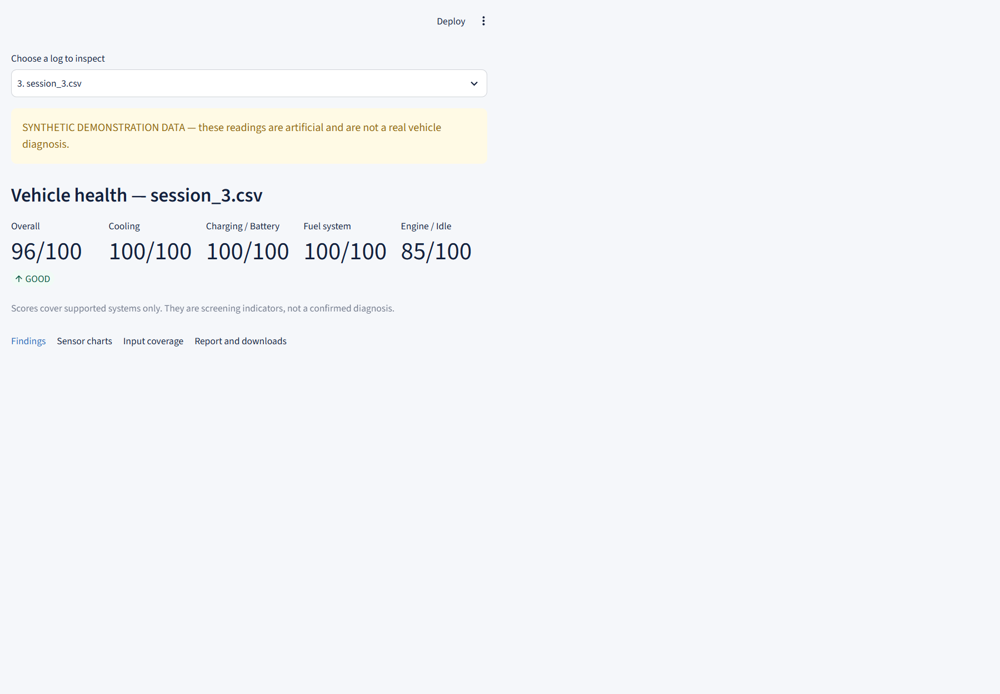
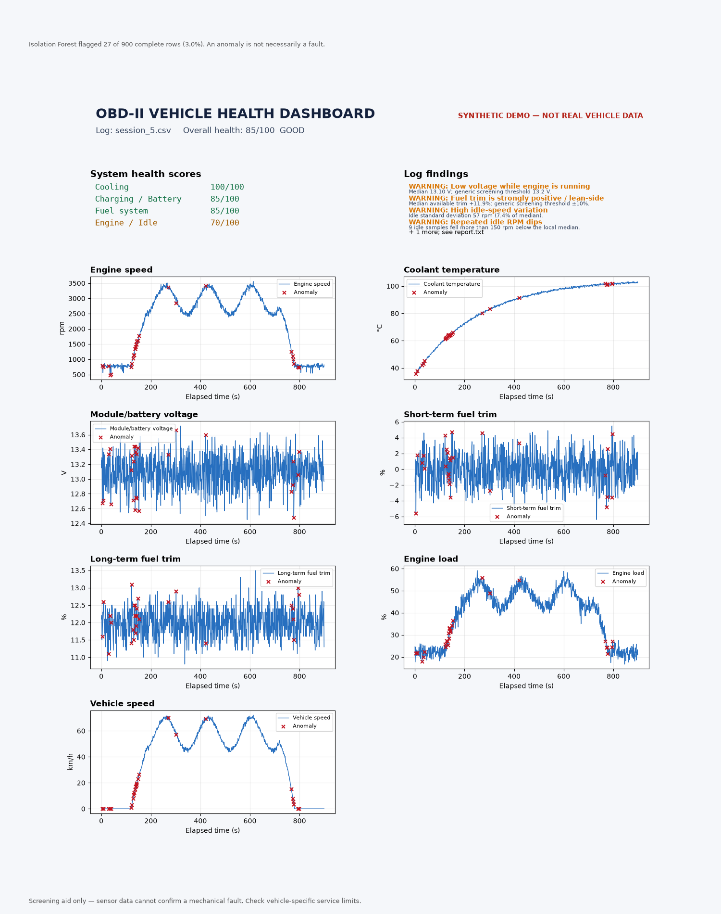
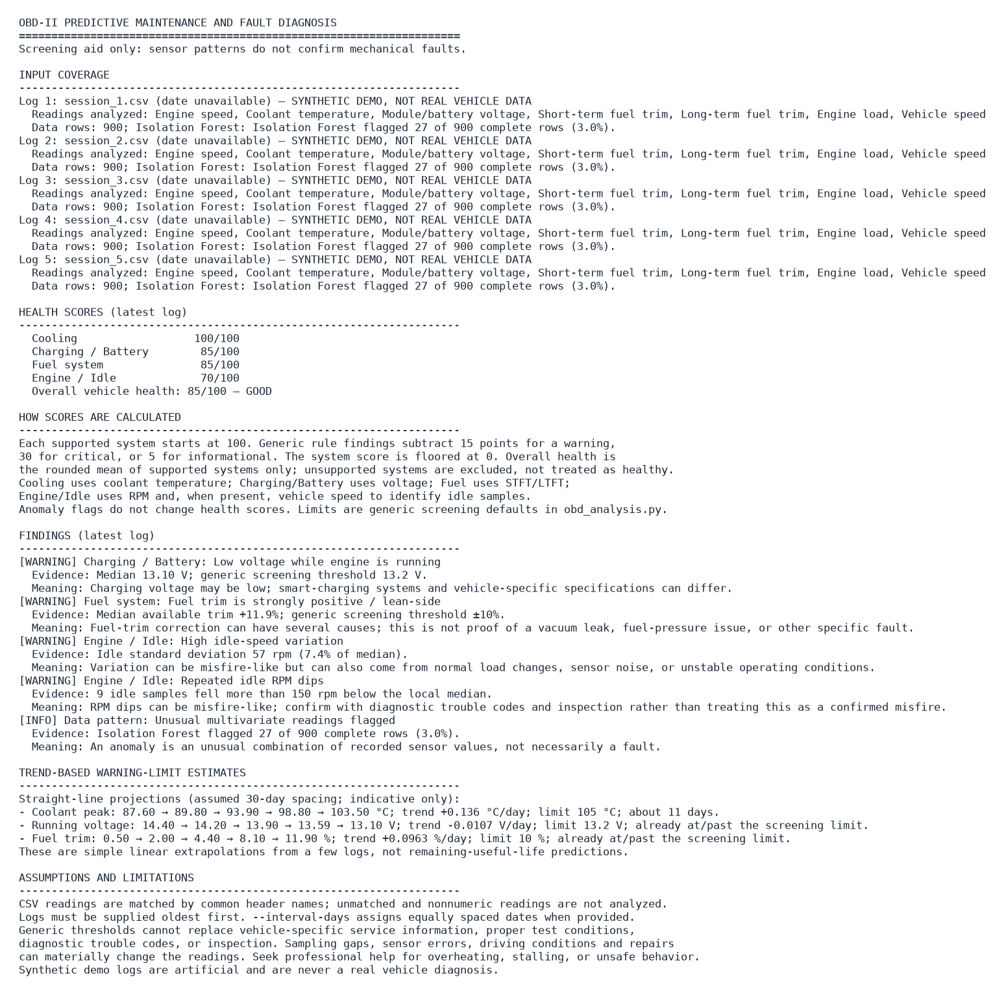

# OBD-II Predictive Maintenance

A simple local screening tool for OBD-II CSV logs. It reads exported vehicle data, highlights health trends, and flags rule-based warnings with plain-English explanations. It is a screening aid, not a confirmed diagnosis.

[](https://www.python.org/) [](LICENSE) [](https://streamlit.io/) [](https://github.com/Baliji-Niroop/OBD-PREDICTIVE-MAINTENANCE/actions)

## What is this?

This project helps a user review OBD-II CSV logs from a car without needing a full diagnostic lab. It matches common app exports, checks a few generic health rules, and presents a simple dashboard for quick review. It is meant for screening and learning, not for proving a specific mechanical fault.

## What it does

- Scores cooling, battery/charging, fuel, and engine/idle health from supported sensor columns.
- Lists findings with evidence, a plain-language explanation, and a severity level.
- Marks unusual multivariate readings with an Isolation Forest anomaly check.
- Projects simple forward trends when at least three dated logs are available, with the bundled demo showing a gradual health shift across several sample CSVs.
- Shows results in a local Streamlit dashboard and a command-line report.

## Demo



*Interactive Streamlit dashboard*



*Static dashboard image (exported by the CLI and from the app)*



*CLI text report*

Screenshots use the bundled synthetic demo data, not a real vehicle.

## Quick start

### Windows

Double-click `Run_Dashboard.bat` in the project folder to start the local dashboard.

First run installs everything automatically and needs internet.

Other helpers: `scripts/windows/Setup_Update_And_Run.bat` (repair/update) and `scripts/windows/Create_Desktop_Shortcuts.ps1` (desktop shortcuts).

### Windows / Mac / Linux manual

```bash
python -m venv .venv
# Windows (PowerShell)
.\.venv\Scripts\Activate.ps1
# macOS / Linux
source .venv/bin/activate
pip install -e .
streamlit run app.py
```

The project also includes a CLI that can be run after installation:

```bash
obd-make-samples
obd-diagnosis data/sample/session_1.csv data/sample/session_2.csv data/sample/session_3.csv data/sample/session_4.csv data/sample/session_5.csv --interval-days 30
```

## How to use

1. Pick either the bundled demo logs or upload your own CSV files in oldest-first order.
2. Enter an interval in days if your logs are not dated in filenames or timestamps.
3. Click Analyze logs to generate the dashboard and report.
4. Read the health summary, inspect findings, and download the report or image.

CLI example:

```bash
obd-diagnosis data/sample/session_1.csv data/sample/session_2.csv data/sample/session_3.csv data/sample/session_4.csv data/sample/session_5.csv --interval-days 30
```

## How it works

```text
CSV logs
  -> column matching and unit cleanup
  -> rule-based checks for coolant, voltage, fuel trim, and idle
  -> health scoring for supported systems
  -> Isolation Forest anomaly detection
  -> simple trend projection
  -> dashboard + report output
```

This flow is described in more detail in [docs/ARCHITECTURE.md](docs/ARCHITECTURE.md).

## Scoring in 30 seconds

| Severity | Points deducted | Typical meaning |
|---|---:|---|
| Info | 5 | Mild or low-confidence signal |
| Warning | 15 | Needs review |
| Critical | 30 | Strong screen trigger |

Systems are scored separately and then averaged. Health = average of the supported systems only; missing systems are excluded rather than treated as healthy.

Overall labels: GOOD = overall score >= 85, FAIR = >= 65, POOR = below 65.

The label comes only from the average score, so a log can show a few warnings and still be GOOD.

## Supported sensors

Headers are matched case-insensitively and accept common punctuation and naming variants from tools such as Torque Pro, Car Scanner, and OBD Fusion.

| Reading | Example headers |
|---|---|
| Engine RPM | `RPM`, `Engine RPM(rpm)`, `Engine speed` |
| Coolant temperature | `Coolant Temperature`, `Engine Coolant Temperature(°C)`, `ECT` |
| Module/battery voltage | `Voltage`, `Control module voltage(V)`, `Battery Voltage` |
| Short-term fuel trim | `STFT`, `Short Term Fuel Trim Bank 1(%)` |
| Long-term fuel trim | `LTFT`, `Long Term Fuel Trim Bank 1(%)` |
| Engine load | `Engine Load(%)`, `Calculated Load` |
| Vehicle speed | `Vehicle speed(km/h)`, `Vehicle Speed` |

## Project status

- [x] Column auto-matching for common OBD export headers
- [x] Generic rule-based findings for cooling, charging, fuel, and idle checks
- [x] Isolation Forest anomaly detection for complete rows
- [x] Simple linear trend projection for dated logs
- [x] Local Streamlit dashboard
- [x] Command-line diagnosis workflow
- [x] Unit tests for analysis and dashboard behavior
- [x] Windows launcher scripts

Known limitations / future ideas:

- [ ] Thresholds are generic screening defaults, not vehicle-specific service limits
- [ ] Trend estimates are simple straight-line guesses, not remaining-life guarantees
- [ ] Tests use bundled synthetic data and a small sample workflow
- [ ] This project is best for screening and review, not repair decisions

## Project structure

```text
OBD-PREDICTIVE-MAINTENANCE/
├── app.py                          # Streamlit entry point
├── README.md                      # Main project guide and setup notes
├── CHANGELOG.md                   # Release and project updates
├── LICENSE                        # MIT license for the project
├── requirements.txt               # Single dependency source: editable install
├── pyproject.toml                 # Package metadata, scripts, and pytest config
├── Run_Dashboard.bat              # One-click Windows dashboard launcher
├── data/
│   ├── sample/                    # Bundled synthetic CSV logs for demo use
│   └── uploads/                  # User CSVs are added here and left unchanged
├── docs/
│   ├── ARCHITECTURE.md            # High-level design and data flow
│   ├── HOW_IT_WORKS.md            # Rule thresholds and sensor handling
│   ├── PROGRESS.md                # Milestone timeline of the project
│   └── images/                   # Demo screenshots
├── output/                        # Generated dashboard and report output
├── scripts/windows/              # Helper scripts for Windows setup and launch
├── .github/workflows/tests.yml    # GitHub Actions test workflow
├── src/obd_predictive/            # Core analysis logic, dashboard renderer, and CLI
│   ├── __init__.py                # Package version metadata
│   ├── make_sample_data.py        # Generates synthetic demo CSVs
│   ├── obd_analysis.py            # Loading, matching, rule checks, scoring, trends
│   ├── obd_dashboard.py           # Static matplotlib dashboard renderer
│   ├── obd_diagnosis.py           # CLI entry point for analysis
│   └── streamlit_dashboard.py     # Browser dashboard interface
├── tests/                         # Regression tests for analysis and UI behavior
├── .gitignore                     # Ignores local env, generated output, and uploads
├── .streamlit/config.toml         # Light dashboard theme config
└── .venv/                         # Local virtual environment (not tracked)
```

## Running tests

```bash
python -m pip install -e .[dev]
python -m pytest
python -m unittest discover -s tests -v
```

## Troubleshooting

**Setup fails on a fresh machine?**

Recreate the virtual environment and run `pip install -e .` before using the app.

**`ModuleNotFoundError: obd_predictive`?**

Install the package in editable mode with `python -m pip install -e .`.

**My CSV is malformed or empty?**

Check the header names and ensure the file is a real CSV with numeric values in supported columns.

**No trend is shown?**

At least three logs with increasing dates or a supplied interval are required for trend estimates.

**Streamlit says port 8501 is already in use?**

Stop the existing local process or start the app on a different port with `streamlit run app.py --server.port 8502`.

## Author

Baliji Niroop<br>
B.Tech Automobile Engineering, VNR VJIET Hyderabad

GitHub: https://github.com/Baliji-Niroop

## License

This project is licensed under the MIT License. See [LICENSE](LICENSE).
